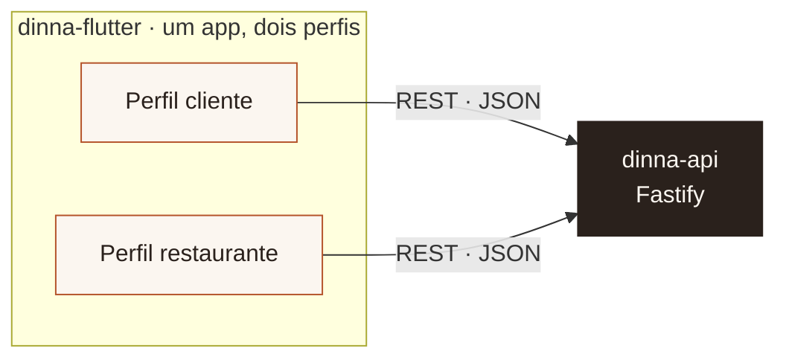
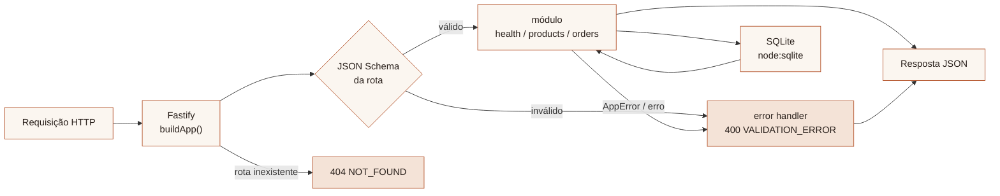
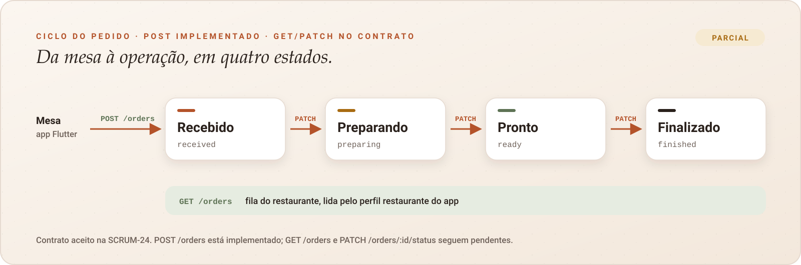
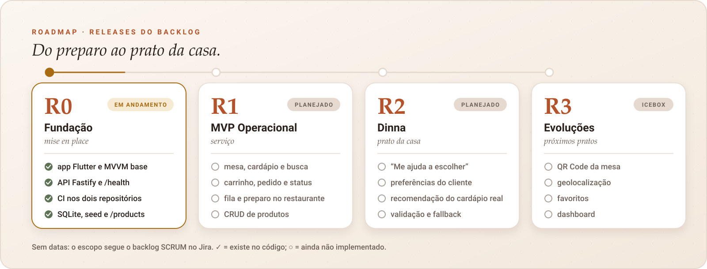

<a id="topo"></a>

<p align="center">
  <picture>
    <source media="(prefers-reduced-motion: reduce)" srcset="docs/assets/readme/hero-still.svg" />
    
  </picture>
</p>

<h1 align="center">dinna-api</h1>

<p align="center">
  <strong>Da mesa à operação.</strong><br />
  A API REST do Dinna: produtos, pedidos, status e, no futuro, recomendações, em um monólito modular simples.
</p>

<p align="center">
  <a href="#comece-aqui"><strong>COMEÇAR →</strong></a>
  &nbsp;·&nbsp;
  <a href="#estado-atual">O QUE JÁ EXISTE</a>
  &nbsp;·&nbsp;
  <a href="docs/api-contract.md">CONTRATO REST</a>
  &nbsp;·&nbsp;
  <a href="#roadmap">ROADMAP</a>
  &nbsp;·&nbsp;
  <a href="CONTRIBUTING.md">CONTRIBUIR</a>
  &nbsp;·&nbsp;
  <a href="https://github.com/jeancarlosaps/dinna-flutter">APLICATIVO FLUTTER DO DINNA</a>
</p>

<p align="center">
  <a href="https://github.com/jeancarlosaps/dinna-api/actions/workflows/ci.yml"></a>
  
  
  
  
</p>

---

## Ecossistema Dinna

| Repositório                                                         | Papel                                                                              | Stack                          |
| ------------------------------------------------------------------- | ---------------------------------------------------------------------------------- | ------------------------------ |
| [**dinna-flutter**](https://github.com/jeancarlosaps/dinna-flutter) | Aplicativo Flutter do Dinna: um app com dois perfis, **cliente** e **restaurante** | Flutter · Dart · Material 3    |
| **dinna-api** (este)                                                | Backend REST: fonte de verdade de produtos, pedidos e status                       | Node.js · TypeScript · Fastify |



O Dinna é um app de pedidos feitos **dentro do restaurante** (não é delivery). O cliente escolhe e envia o pedido da mesa; o restaurante recebe, prepara e finaliza, sem perder o atendimento humano. Esta API é o ponto em que as duas pontas se encontram.

<a id="estado-atual"></a>

## 01 · Estado atual

Fundação (R0) **em andamento**. Health, SQLite, seed de cardápio e CRUD de `/products` estão prontos. O módulo de pedidos começou com `POST /orders`; consulta e atualização de status seguem no contrato.

| Item                                                                 | Situação                                       |
| -------------------------------------------------------------------- | ---------------------------------------------- |
| Servidor Fastify + TypeScript strict                                 | ✅ Implementado                                |
| `GET /health`                                                        | ✅ Implementado e testado                      |
| Formato único de erro (400 / 404 / `AppError` / 500)                 | ✅ Implementado e testado                      |
| Validação de entrada com JSON Schema nativo do Fastify               | ✅ Em uso nas rotas de produtos                |
| Variáveis de ambiente (`HOST`, `PORT`, `LOG_LEVEL`, `DATABASE_PATH`) | ✅ Implementado e testado                      |
| Lint, format, typecheck, testes, build, CI                           | ✅ 19 testes · GitHub Actions                  |
| `/products` (CRUD + filtros)                                         | ✅ Implementado e testado (SCRUM-25)           |
| Persistência SQLite (`node:sqlite`) + seed                           | ✅ Implementado                                |
| `POST /orders`                                                       | ✅ Implementado e testado (SCRUM-45)           |
| `GET /orders`, `PATCH /orders/:id/status`                            | ⬜ Contrato R1, [aceito](docs/api-contract.md) |
| `/ai/recommendation`                                                 | ⬜ Planejado (R2)                              |
| Autenticação                                                         | ⬜ Fora do escopo atual                        |

---

## 02 · Stack

| Peça                       | Versão                                    | Por quê                                                                       |
| -------------------------- | ----------------------------------------- | ----------------------------------------------------------------------------- |
| Node.js                    | 24 LTS na CI (`.nvmrc`); mínimo `>=22.13` | Linha LTS; carrega `.env` nativamente (`--env-file-if-exists`)                |
| TypeScript                 | 6.0.3, `strict`                           | O typescript-eslint 8 só suporta TypeScript `<6.1`, por isso não usamos o 7.x |
| Fastify                    | 5.12.7                                    | Rápido e simples, com validação por JSON Schema embutida e plugins por módulo |
| Vitest                     | 5.0.5                                     | Testes rápidos com `app.inject`, sem abrir porta                              |
| ESLint + typescript-eslint | 10.13.0 + 8.71.2                          | Lint com regras recomendadas                                                  |
| Prettier                   | 3.9.10                                    | Formatação única                                                              |
| tsx                        | 4.23.15                                   | `npm run dev` com reload                                                      |
| SQLite                     | `node:sqlite` (built-in, experimental)    | Sem dependência nativa extra; arquivo local em `data/dinna.sqlite`            |

A única dependência de runtime publicada no npm é `fastify`. Persistência usa o módulo nativo `node:sqlite` (sem ORM nem `dotenv`).

## 03 · Arquitetura

Monólito modular: **um processo, um deploy, um módulo por recurso.** Nada de microserviços, CQRS ou camadas sem uso.



| Arquivo                                                                              | Responsabilidade                                                                    |
| ------------------------------------------------------------------------------------ | ----------------------------------------------------------------------------------- |
| [`src/app.ts`](src/app.ts)                                                           | `buildApp()`: monta o Fastify sem abrir porta. É usado pelo servidor e pelos testes |
| [`src/server.ts`](src/server.ts)                                                     | Lê o ambiente, abre a porta e encerra com `SIGINT`/`SIGTERM`                        |
| [`src/config/env.ts`](src/config/env.ts)                                             | Lê e valida as variáveis de ambiente                                                |
| [`src/db/client.ts`](src/db/client.ts)                                               | Abre o SQLite, aplica schema e seed                                                 |
| [`src/shared/errors/app-error.ts`](src/shared/errors/app-error.ts)                   | `AppError`: erro de domínio com status HTTP                                         |
| [`src/shared/http/error-handler.ts`](src/shared/http/error-handler.ts)               | Formato único de erro e handler de 404                                              |
| [`src/modules/health/health.routes.ts`](src/modules/health/health.routes.ts)         | `GET /health`                                                                       |
| [`src/modules/products/products.routes.ts`](src/modules/products/products.routes.ts) | CRUD `/products`                                                                    |
| [`src/modules/orders/orders.routes.ts`](src/modules/orders/orders.routes.ts)         | Criação de pedidos (`POST /orders`)                                                 |

### Estrutura real

```text
src/
├── app.ts
├── server.ts
├── config/
│   └── env.ts
├── db/
│   ├── client.ts            # openDatabase + seed
│   ├── schema.ts
│   ├── seed.ts
│   └── types.ts
├── modules/
│   ├── health/
│   │   └── health.routes.ts
│   ├── orders/
│   │   ├── orders.routes.ts
│   │   └── orders.repository.ts
│   └── products/
│       ├── products.routes.ts
│       └── products.repository.ts
└── shared/
    ├── errors/app-error.ts
    └── http/error-handler.ts
tests/
├── env.test.ts
├── error-handler.test.ts
├── health.test.ts
├── orders.test.ts
└── products.test.ts
docs/
├── api-contract.md          # contrato REST aceito (SCRUM-24)
└── assets/readme/           # ilustrações deste README
```

### Como adicionar um módulo

1. Crie `src/modules/<recurso>/<recurso>.routes.ts` exportando um plugin `async (app) => { ... }`.
2. Declare um `schema` (`body`, `params`, `querystring`, `response`) em cada rota. A validação é automática e os erros viram `400 VALIDATION_ERROR`.
3. Lance `AppError(status, code, message)` para os erros de negócio.
4. Registre o módulo em `src/app.ts` com `app.register(...)`.
5. Teste com `buildApp().inject(...)` em `tests/`.

<a id="comece-aqui"></a>

## 04 · Comece aqui

### Requisitos

- Node.js 24. Com [nvm](https://github.com/nvm-sh/nvm), rode `nvm use` na raiz para ler o `.nvmrc`.
- npm (vem com o Node).

### Instalação

```bash
git clone git@github.com:jeancarlosaps/dinna-api.git
cd dinna-api
npm install
cp .env.example .env
```

### Configuração de ambiente

| Variável        | Padrão              | Descrição                                                                            |
| --------------- | ------------------- | ------------------------------------------------------------------------------------ |
| `HOST`          | `0.0.0.0`           | Interface de escuta. `0.0.0.0` permite o acesso de emuladores e dispositivos na rede |
| `PORT`          | `3333`              | Porta HTTP (1–65535)                                                                 |
| `LOG_LEVEL`     | `info`              | `fatal`, `error`, `warn`, `info`, `debug`, `trace` ou `silent`                       |
| `DATABASE_PATH` | `data/dinna.sqlite` | Arquivo SQLite. Testes usam `:memory:` via `buildApp()`                              |

Valores inválidos fazem a API falhar ao iniciar, com mensagem explícita. O `.env` **nunca** é versionado; só o `.env.example`.

### Execução local

```bash
npm run dev      # desenvolvimento, com reload (tsx watch)
```

```bash
npm run build    # compila para dist/
npm start        # roda o build compilado
```

### Health check

```bash
curl http://localhost:3333/health
```

```json
{ "status": "ok" }
```

Rota inexistente:

```bash
curl http://localhost:3333/nao-existe
```

```json
{ "error": { "code": "NOT_FOUND", "message": "Rota GET /nao-existe não encontrada" } }
```

---

## 05 · Contratos REST

<p align="center">
  
</p>

| Método   | Rota                 | Release | Situação         |
| -------- | -------------------- | ------- | ---------------- |
| `GET`    | `/health`            | R0      | **Implementado** |
| `GET`    | `/products`          | R0/R1   | **Implementado** |
| `GET`    | `/products/:id`      | R0/R1   | **Implementado** |
| `POST`   | `/products`          | R0/R1   | **Implementado** |
| `PUT`    | `/products/:id`      | R0/R1   | **Implementado** |
| `DELETE` | `/products/:id`      | R0/R1   | **Implementado** |
| `GET`    | `/orders`            | R1      | Planejado        |
| `POST`   | `/orders`            | R1      | **Implementado** |
| `PATCH`  | `/orders/:id/status` | R1      | Planejado        |
| `POST`   | `/ai/recommendation` | R2      | Planejado        |

Payloads, status e convenções estão em [`docs/api-contract.md`](docs/api-contract.md). O contrato foi **aceito** na **SCRUM-24** e é a fonte de verdade entre esta API e o app Flutter.

### Convenções de erro

Todas as respostas de erro usam o mesmo formato:

```json
{ "error": { "code": "VALIDATION_ERROR", "message": "...", "details": [] } }
```

| HTTP | `code`                 | Quando                                                         |
| ---- | ---------------------- | -------------------------------------------------------------- |
| 400  | `VALIDATION_ERROR`     | Body, params ou query fora do schema (`details` traz os erros) |
| 404  | `NOT_FOUND`            | Rota inexistente                                               |
| 4xx  | definido no `AppError` | Regra de negócio (ex.: 409 em conflito)                        |
| 500  | `INTERNAL_ERROR`       | Erro inesperado; o detalhe vai só para o log                   |

## 06 · Banco de dados

**Decisão (SCRUM-25):** `node:sqlite` (módulo nativo do Node.js 24). Sem `better-sqlite3`, sem ORM.

- Arquivo padrão: `data/dinna.sqlite` (criado na primeira subida; pasta no `.gitignore`).
- Testes: `:memory:` via `buildApp()` — isolados e sem arquivo em disco.
- Schema: tabelas `products`, `orders` e `order_items` (pedidos só no schema por enquanto).
- Seed: 12 produtos (`p1`–`p12`) em [`src/db/seed.ts`](src/db/seed.ts) quando a tabela está vazia.
- Status experimental do Node: a API sobe com um `ExperimentalWarning` do runtime; aceitável no MVP acadêmico.

> Não confunda com a **persistência local do app Flutter** (carrinho, preferências, último pedido), que é a SCRUM-27. São responsabilidades diferentes.

---

## 07 · Testes e qualidade

| Comando                | O que faz                          |
| ---------------------- | ---------------------------------- |
| `npm test`             | Vitest (`vitest run`)              |
| `npm run test:watch`   | Vitest em modo watch               |
| `npm run lint`         | ESLint                             |
| `npm run typecheck`    | `tsc --noEmit`                     |
| `npm run format`       | Prettier, reescrevendo os arquivos |
| `npm run format:check` | Prettier, só verificando           |
| `npm run build`        | Compila para `dist/`               |

O que os 19 testes cobrem:

| Arquivo                       | Cobre                                                                           |
| ----------------------------- | ------------------------------------------------------------------------------- |
| `tests/health.test.ts`        | `GET /health` responde 200 com `{ "status": "ok" }`                             |
| `tests/error-handler.test.ts` | 404 padronizado, 400 de validação, `AppError` e 500 sem vazar o detalhe         |
| `tests/env.test.ts`           | Valores padrão e rejeição de `PORT`, `LOG_LEVEL` e `DATABASE_PATH`              |
| `tests/products.test.ts`      | Listagem/filtros, detalhe, create, update, soft-delete e erros                  |
| `tests/orders.test.ts`        | Criação, status inicial, total, validação, produtos indisponíveis e atomicidade |

## 08 · CI

O workflow [`.github/workflows/ci.yml`](.github/workflows/ci.yml) roda em todo push na `main` e em todo pull request:

```text
checkout → Node (versão do .nvmrc) → npm ci → format:check → lint → typecheck → test → build
```

Não há deploy nem ambiente de produção.

## 09 · Integração com o app Flutter

O app aponta para esta API pela variável `API_BASE_URL` (veja o [README do app](https://github.com/jeancarlosaps/dinna-flutter#comece-aqui)). Com `HOST=0.0.0.0`:

| Onde o app roda    | URL da API                               |
| ------------------ | ---------------------------------------- |
| iOS Simulator      | `http://localhost:3333`                  |
| Android Emulator   | `http://10.0.2.2:3333`                   |
| Dispositivo físico | `http://<IP-do-computador-na-rede>:3333` |

Hoje o app chama `GET /health` na tela inicial (**“Verificar conexão com a API”**) e lê o formato de erro no `ApiClient`. O cardápio via `GET /products` já está disponível nesta API para a próxima integração no Flutter.

<a id="roadmap"></a>

## 10 · Roadmap

<p align="center">
  
</p>

Issues de API acompanhadas neste repositório. **Jira** foi consultado em 25/10/2026; **Código** reflete esta branch.

| Issue    | Task                                   | Jira         | Código                                                     |
| -------- | -------------------------------------- | ------------ | ---------------------------------------------------------- |
| SCRUM-24 | Definir o contrato inicial da API REST | Concluído    | Contrato aceito em `docs/api-contract.md`                  |
| SCRUM-25 | Preparar backend/mock da API           | Concluído    | SQLite + seed + CRUD `/products`; schema de pedidos        |
| SCRUM-45 | Criar pedido (`POST /orders`)          | Em andamento | Rota com validação, total calculado e persistência atômica |

## 11 · Como contribuir

O fluxo completo está em [CONTRIBUTING.md](CONTRIBUTING.md). Em resumo:

1. Pegue uma issue no [Jira (SCRUM)](https://jeancarlosaps.atlassian.net/jira/software/projects/SCRUM/boards/1).
2. Crie a branch a partir da `main`: `feature/SCRUM-<n>-descricao`, `fix/SCRUM-<n>-descricao` ou `chore/SCRUM-<n>-descricao`.
3. Valide antes do PR: `npm run format:check && npm run lint && npm run typecheck && npm test`.
4. Abra o PR usando o [template](.github/pull_request_template.md), com a CI verde e a revisão de outro integrante.

## 12 · Equipe

| Integrante    | Foco planejado no backlog                                    |
| ------------- | ------------------------------------------------------------ |
| Jean Carlos   | Arquitetura e fundação, QA de arquitetura                    |
| Felipe Souza  | Contrato REST, backend/mock da API e operação do restaurante |
| Gabriel Abreu | Experiência do cliente e estrutura visual                    |
| João Victor   | Persistência e evoluções                                     |

Os focos vêm da distribuição de issues no backlog (Atividade 2) e não são cargos formais.

## 13 · Próximos passos

1. **R1:** completar o módulo `orders` com `GET /orders` e `PATCH /orders/:id/status` sobre o schema existente.
2. **R2:** implementar `POST /ai/recommendation` conforme o contrato.
3. Sincronizar o `roadmap.svg` no [dinna-flutter](https://github.com/jeancarlosaps/dinna-flutter) se o status R0 mudar lá também.

## 14 · Links

- Jira (SCRUM): <https://jeancarlosaps.atlassian.net/jira/software/projects/SCRUM/boards/1>
- Figma: <https://www.figma.com/design/xYeeN6UBmj3lF458GF9qwA/Dinna-%C2%B7-App-Cliente?node-id=0-1>
- Aplicativo Flutter do Dinna: <https://github.com/jeancarlosaps/dinna-flutter>
- Contrato REST: [docs/api-contract.md](docs/api-contract.md)
- Sistema visual dos READMEs: [docs/assets/readme/DESIGN.md](docs/assets/readme/DESIGN.md)

<p align="center"><sub>Projeto acadêmico · Pós Mobile UTFPR · disciplina de Flutter · <a href="#topo">voltar ao topo ↑</a></sub></p>
